# Teral

**A local-first, terminal-native knowledge system written in Go.**

Teral is a fast, minimal, extensible knowledge management system. Your notes are plain Markdown files on your own disk. Teral layers an index, a link graph, full-text and semantic search, encryption, sync, scripting, and a plugin system on top of them, without ever locking your data into a proprietary format.


---

## Table of Contents

1. [Vision](#1-vision)
2. [Design Principles](#2-design-principles)
3. [Project Status](#3-project-status)
4. [System Architecture](#4-system-architecture)
5. [Core Data Model](#5-core-data-model)
6. [Vault Layout and Storage](#6-vault-layout-and-storage)
7. [Runtime Flows](#7-runtime-flows)
8. [Feature Catalogue](#8-feature-catalogue)
9. [Experimental and Novel Ideas](#9-experimental-and-novel-ideas)
10. [Roadmap](#10-roadmap)
11. [Technology Stack](#11-technology-stack)
12. [Repository Structure](#12-repository-structure)
13. [Getting Started](#13-getting-started)
14. [Configuration](#14-configuration)
15. [Keybindings](#15-keybindings)
16. [Command Line Interface](#16-command-line-interface)
17. [Performance Targets](#17-performance-targets)
18. [Security Model](#18-security-model)
19. [Testing and Quality Strategy](#19-testing-and-quality-strategy)
20. [Contributing](#20-contributing)
21. [Acknowledgements](#21-acknowledgements)
22. [License](#22-license)

---

## 1. Vision

Most note-taking tools force a trade-off. Either they are simple and fast but shallow, or they are powerful but heavy, cloud-bound, and opaque about where your data lives.

Teral aims to remove that trade-off:

- **Your files are the source of truth.** Every note is a Markdown file. Delete Teral tomorrow and your knowledge is still readable by any editor on earth.
- **The terminal is a first-class home.** A keyboard-driven interface that starts instantly, works over SSH, and never leaves the keyboard.
- **Power is layered, not forced.** A new user gets a clean editor and a note list. A power user gets a link graph, queries, scripting, encryption, sync, and plugins. Nothing is mandatory.
- **Everything is a library first.** The TUI is only one frontend. The same core powers a CLI, a local daemon, an HTTP/gRPC API, and future desktop and web clients.

The long-term goal is a complete personal knowledge platform: capture, organize, connect, retrieve, and reason over everything you know, entirely under your control.

---

## 2. Design Principles

| Principle           | What it means in practice                                                                  |
| ------------------- | ------------------------------------------------------------------------------------------ |
| Local-first         | Full functionality offline. Network features are additive and optional.                    |
| Plain text forever  | Markdown plus YAML front matter. No lock-in. The index is a disposable cache.              |
| Rebuildable state   | Any derived data (index, graph, embeddings) can be deleted and regenerated from the vault. |
| Library-first core  | UI-agnostic `core` packages with stable interfaces. Frontends are thin.                  |
| Explicit over magic | Predictable behavior, documented file formats, no hidden mutation of user files.           |
| Fast by default     | Instant startup, incremental indexing, lazy loading, streaming I/O.                        |
| Safe by default     | Atomic writes, crash recovery, optional end-to-end encryption, no telemetry.               |
| Extensible          | Plugin API, scripting hooks, and event bus for every meaningful action.                    |
| Testable            | Pure state transitions, interface-driven storage, deterministic fixtures.                  |
| Portable            | Single static binary on Linux, macOS, and Windows.                                         |

---

## 3. Project Status

Teral is in the **design and foundation** stage. This document is the product definition and the contract for everything that follows. Features are tagged by phase in the [Feature Catalogue](#8-feature-catalogue) and sequenced in the [Roadmap](#10-roadmap).

Legend used throughout this document:

- `[P0]` Foundation: needed for a usable first release
- `[P1]` Core: makes it a serious knowledge tool
- `[P2]` Advanced: power-user and ecosystem features
- `[P3]` Frontier: ambitious, experimental, or research-level

---

## 4. System Architecture

### 4.1 High-Level Overview

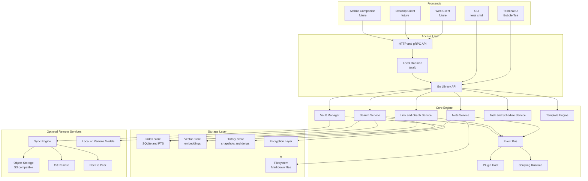

### 4.2 Layered Architecture

Dependencies only point downward. Upper layers never leak into lower ones.

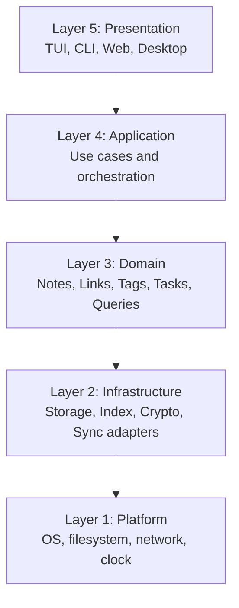

### 4.3 The Elm Architecture in the TUI

The terminal frontend follows the Model-View-Update pattern provided by Bubble Tea. All state transitions are pure functions of `(Model, Msg)`, and all side effects are expressed as commands that return messages.

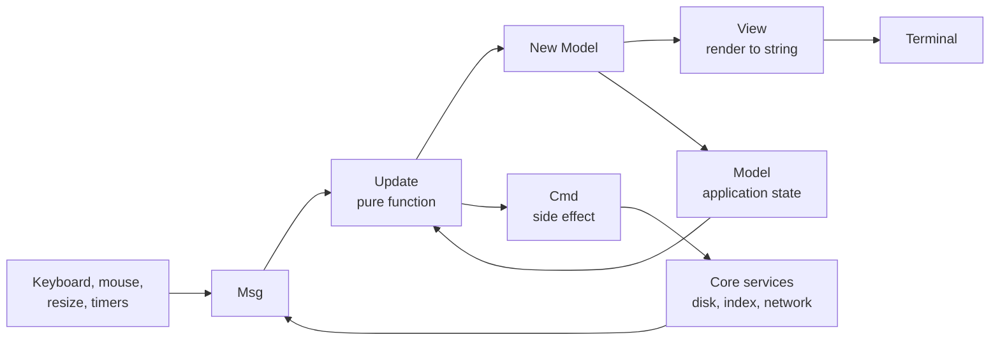

### 4.4 Component Interaction Map

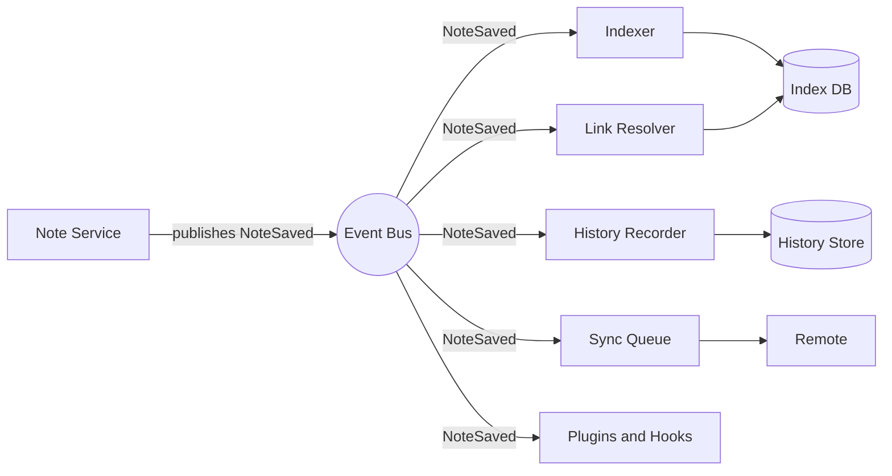

### 4.5 Deployment Modes

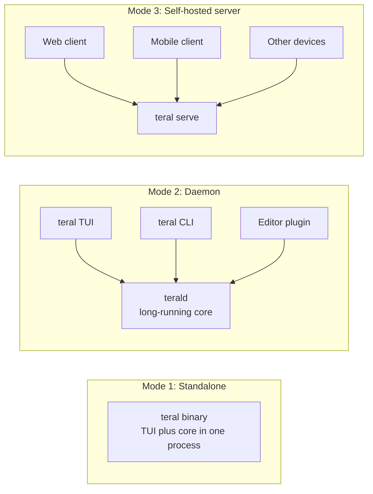

---

## 5. Core Data Model

### 5.1 Entity Relationship Diagram

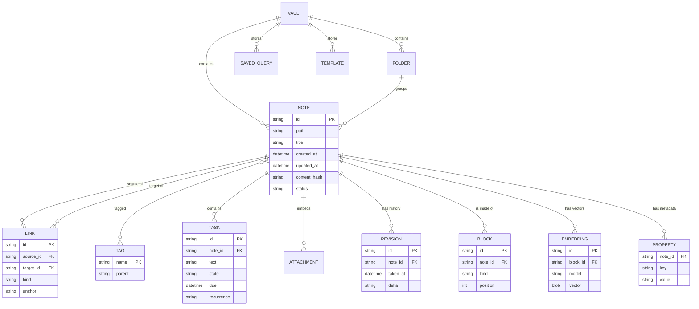

### 5.2 Note Lifecycle

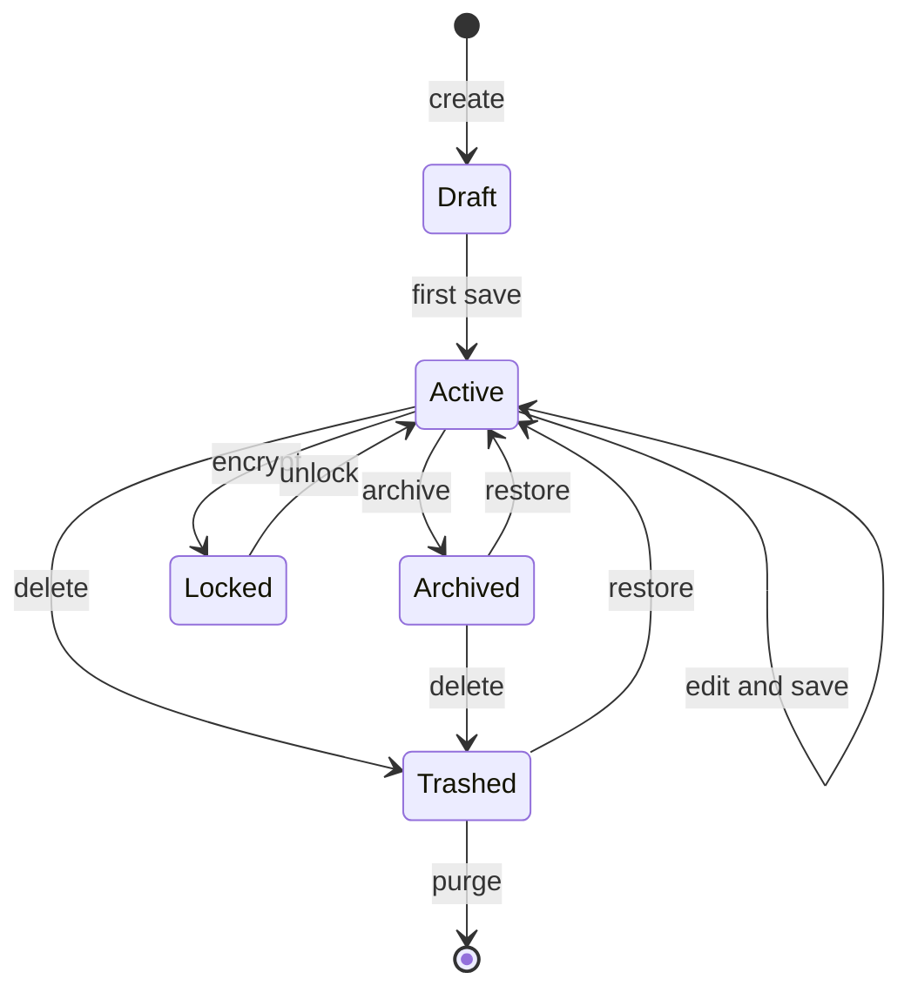

### 5.3 Note File Format

Every note is a UTF-8 Markdown file with optional YAML front matter.

```markdown
---
id: 01JABCDEF0123456789XYZ
title: Designing a Write-Ahead Log
created: 2026-10-15T09:30:00Z
updated: 2026-10-15T10:05:00Z
tags: [systems, storage, databases]
aliases: [WAL design]
status: active
---

# Designing a Write-Ahead Log

A write-ahead log guarantees durability by recording changes before applying them.
See also [[Crash Recovery]] and [[fsync semantics|why fsync matters]].

- [ ] Benchmark sequential vs batched appends @due(2026-10-20)
- [x] Read the SQLite WAL documentation

![[wal-diagram.png]]
```

The identifier in the front matter makes links resilient to renames and moves.

---

## 6. Vault Layout and Storage

### 6.1 On-Disk Layout

```text
~/teral/                       (or any directory you choose)
├── inbox/                     quick capture destination
├── journal/
│   └── 2026/10/2026-10-15.md  daily notes
├── projects/
├── areas/
├── resources/
├── archive/
├── attachments/               images, PDFs, audio
├── templates/                 note templates
├── .teral/
│   ├── config.toml            vault-level configuration
│   ├── index.db               SQLite index (disposable cache)
│   ├── vectors.db             embeddings (disposable cache)
│   ├── history/               snapshots and deltas
│   ├── plugins/               installed plugins
│   ├── trash/                 soft-deleted notes
│   ├── locks/                 advisory lock files
│   └── sync/                  sync state and manifests
└── README.md
```

### 6.2 Write Path: Atomic and Crash Safe

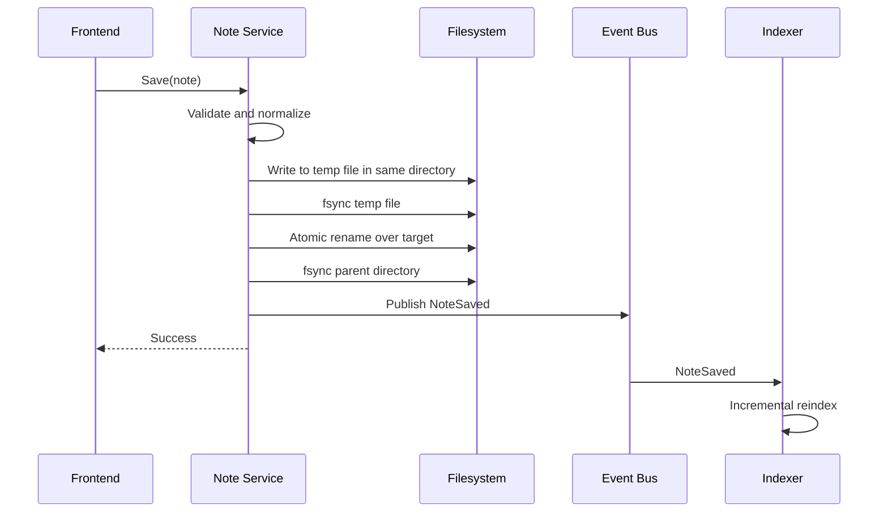

### 6.3 Indexing Pipeline

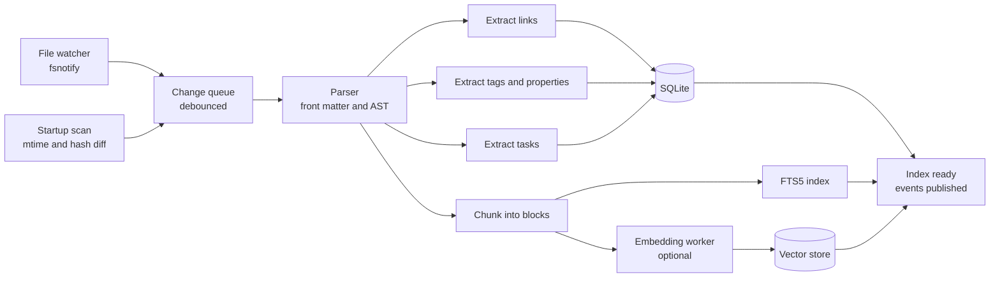

### 6.4 Search Architecture

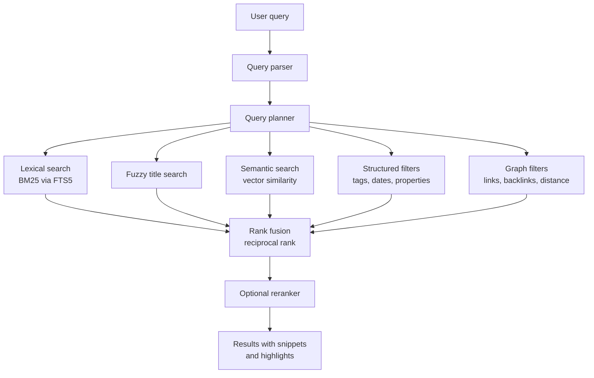

---

## 7. Runtime Flows

### 7.1 Application Startup

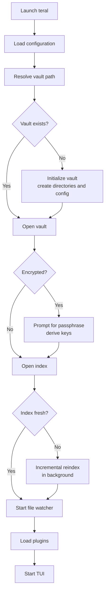

### 7.2 Editing and Saving a Note

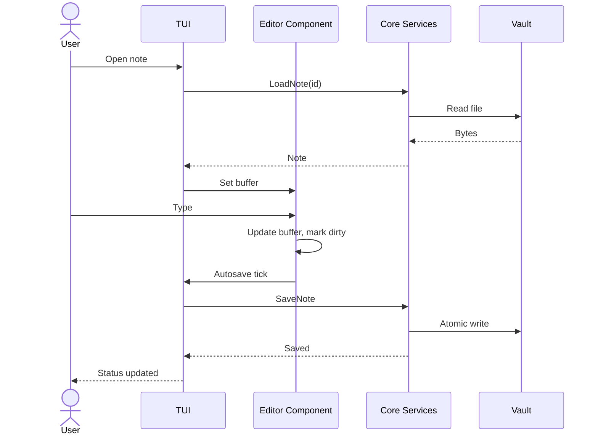

### 7.3 Link Resolution and Backlinks

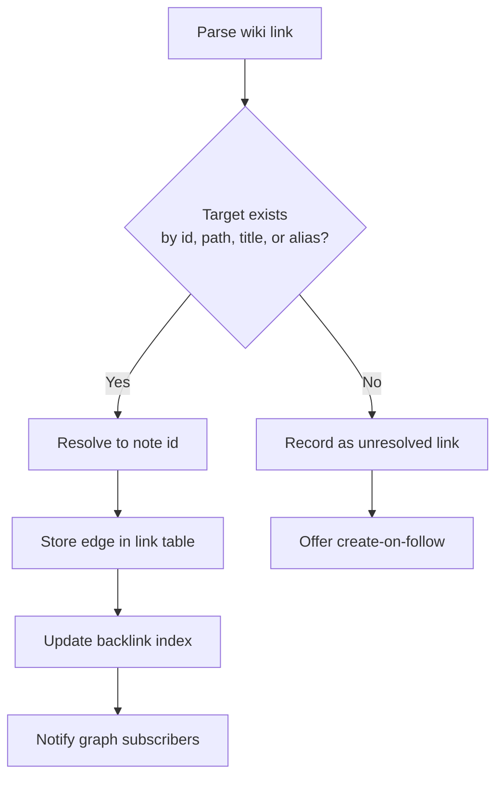

### 7.4 Sync Flow

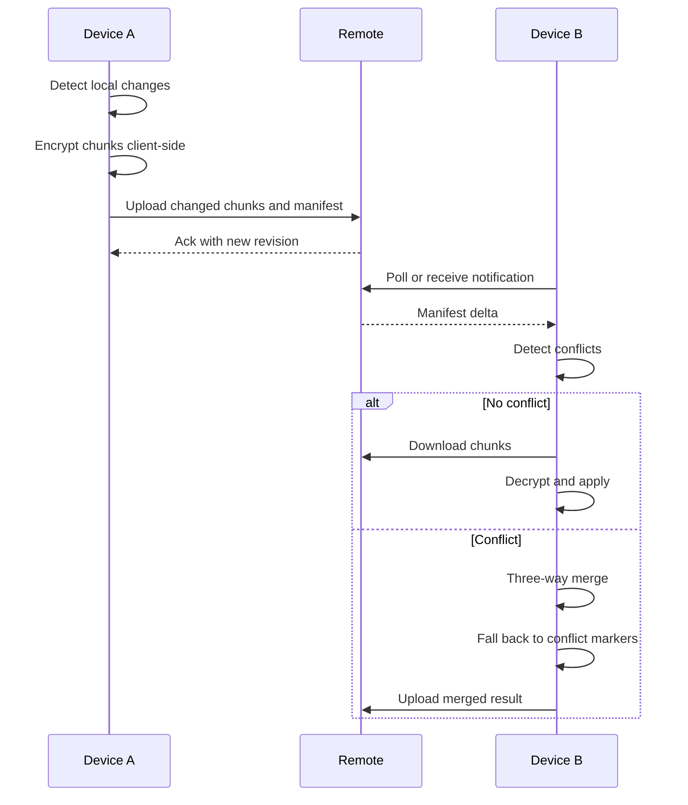

### 7.5 Plugin Lifecycle

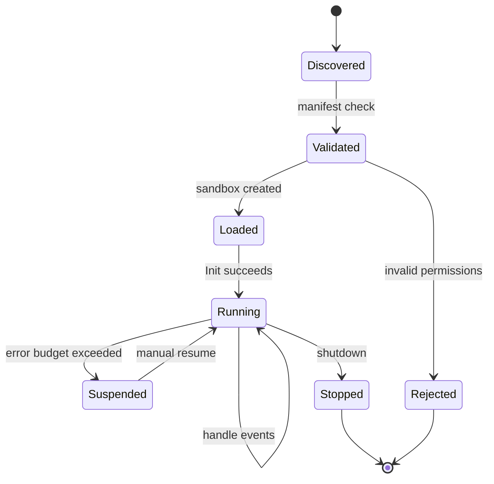

---

## 8. Feature Catalogue

This is the complete scope of Teral. Features are grouped by domain and tagged by phase.

### 8.1 Capture and Editing

- `[P0]` Create, open, rename, move, and delete notes
- `[P0]` Multi-line editor with undo and redo
- `[P0]` Autosave with configurable interval
- `[P0]` Atomic, crash-safe writes
- `[P0]` Delete note with confirmation (`Ctrl+D`)
- `[P1]` Vim keybinding mode and Emacs keybinding mode
- `[P1]` Modal editing option (normal, insert, visual)
- `[P1]` Syntax highlighting for Markdown and fenced code blocks
- `[P1]` Text selection, highlight, and annotation marks
- `[P1]` Multi-cursor editing
- `[P1]` Soft wrap, line numbers, and distraction-free mode
- `[P1]` Split panes: editor and preview, or two notes side by side
- `[P1]` Tabs and a buffer list for multiple open notes
- `[P1]` Smart list continuation, auto-indent, and auto-pairing
- `[P1]` Table editor with alignment and cell navigation
- `[P2]` Spell checking with custom dictionaries
- `[P2]` Grammar and style hints (offline)
- `[P2]` Snippet expansion and abbreviations
- `[P2]` Command palette for every action
- `[P2]` Quick capture from the CLI, stdin, and a global hotkey daemon
- `[P2]` Capture from clipboard, browser extension, and email-in
- `[P2]` Voice capture with local transcription
- `[P3]` Collaborative cursors for real-time co-editing

### 8.2 Vault and File Management

- `[P0]` Local vault directory with plain Markdown files
- `[P0]` Note list with modified time, sorted and filterable
- `[P0]` Folder hierarchy browsing
- `[P1]` Stable note identifiers that survive renames and moves
- `[P1]` Rename with automatic link rewriting across the vault
- `[P1]` Soft delete with trash and restore
- `[P1]` Archive and unarchive
- `[P1]` Multiple vaults with fast switching
- `[P1]` Attachment management for images, PDFs, and audio
- `[P1]` Duplicate detection and merge tool
- `[P2]` Bulk operations: move, tag, rename, retitle by pattern
- `[P2]` Vault health check: broken links, orphans, duplicates, empty notes
- `[P2]` Vault statistics: word counts, growth over time, link density
- `[P2]` Large vault optimization with lazy loading and virtualized lists
- `[P3]` Virtual folders defined by queries

### 8.3 Linking and Knowledge Graph

- `[P1]` Wiki-style links: `[[Note]]`, `[[Note|alias]]`, `[[Note#Heading]]`
- `[P1]` Backlinks panel and outgoing links panel
- `[P1]` Unlinked mentions detection with one-key conversion to links
- `[P1]` Link autocompletion while typing
- `[P1]` Follow link, go back, go forward navigation stack
- `[P2]` Block-level references and transclusion: `![[Note#^block]]`
- `[P2]` Typed links such as `supports::`, `contradicts::`, `depends-on::`
- `[P2]` ASCII and Unicode graph view in the terminal
- `[P2]` Exportable graph to Graphviz, GEXF, and interactive HTML
- `[P2]` Local graph around the current note with configurable depth
- `[P2]` Graph analytics: centrality, clusters, bridges, orphans
- `[P2]` Shortest path between two notes
- `[P3]` Automatic link suggestions using embeddings
- `[P3]` Concept maps and canvas boards with free-form layout
- `[P3]` Knowledge gap detection: topics referenced often but never defined

### 8.4 Organization and Metadata

- `[P1]` Tags with nesting such as `#systems/storage`
- `[P1]` YAML front matter properties with typed values
- `[P1]` Aliases for notes
- `[P1]` Pinned and favorite notes
- `[P1]` Daily, weekly, monthly, and yearly notes
- `[P2]` Maps of Content and index notes generated from queries
- `[P2]` Collections and saved views
- `[P2]` Custom schemas: define a note type and validate its properties
- `[P2]` Smart folders using dynamic queries
- `[P2]` Automatic tagging suggestions
- `[P3]` Ontology support with tag hierarchies and inference rules

### 8.5 Search and Retrieval

- `[P0]` Fuzzy filter over note titles
- `[P1]` Full-text search with ranking and snippets
- `[P1]` Search by tag, date, property, folder, and link relationship
- `[P1]` Search within the current note
- `[P1]` Regex search and replace across the vault
- `[P1]` Saved searches
- `[P2]` Query language with boolean operators, ranges, and grouping
- `[P2]` Embedded live queries inside notes that render result tables
- `[P2]` Semantic search using local embeddings
- `[P2]` Hybrid ranking combining lexical and semantic results
- `[P2]` Recent and frequent notes ranking
- `[P3]` Natural language queries translated to structured queries
- `[P3]` Question answering over the vault with cited sources
- `[P3]` Temporal queries: "what did I know about X in March"

### 8.6 Rendering and Preview

- `[P1]` Rendered Markdown preview in the terminal
- `[P1]` Themes and color schemes, light and dark
- `[P1]` Code block highlighting for many languages
- `[P2]` Inline images using terminal graphics protocols (Kitty, iTerm2, Sixel)
- `[P2]` Math rendering for LaTeX expressions
- `[P2]` Mermaid and diagram rendering to images
- `[P2]` Table of contents sidebar and outline navigation
- `[P2]` Folding of headings and lists
- `[P3]` Live executable code blocks with captured output
- `[P3]` Presentation mode that turns a note into slides

### 8.7 Tasks, Time, and Planning

- `[P1]` Checkbox tasks parsed from any note
- `[P1]` Global task view across the vault
- `[P2]` Due dates, start dates, priorities, and contexts
- `[P2]` Recurring tasks with flexible rules
- `[P2]` Calendar view and agenda view
- `[P2]` Reminders and desktop notifications
- `[P2]` Time tracking per task and per note
- `[P2]` Kanban boards generated from note properties
- `[P3]` Habit tracking and streaks
- `[P3]` Weekly review workflow with guided prompts
- `[P3]` Two-way sync with CalDAV and other calendar systems

### 8.8 Templates and Automation

- `[P1]` Note templates with variables such as date, title, and cursor position
- `[P2]` Template prompts that ask the user for values on creation
- `[P2]` Automatic file naming and foldering rules
- `[P2]` Triggers and hooks: on create, on save, on link, on tag
- `[P2]` Scheduled jobs such as daily note creation and stale note review
- `[P3]` Visual workflow builder for automations
- `[P3]` Webhooks in and out

### 8.9 Versioning and History

- `[P1]` Automatic snapshots on save with retention rules
- `[P1]` Per-note history browser with diff view
- `[P1]` Restore any previous version
- `[P2]` Whole-vault point-in-time restore
- `[P2]` Optional Git integration: commit on save, push, and pull
- `[P2]` Word-level and semantic diffs
- `[P3]` Branching notes: explore alternative drafts and merge them back
- `[P3]` Blame view showing when each paragraph was written

### 8.10 Security and Privacy

- `[P1]` No telemetry by default, ever
- `[P1]` Per-note encryption with a passphrase
- `[P2]` Whole-vault encryption using authenticated encryption (XChaCha20-Poly1305 or AES-GCM)
- `[P2]` Key derivation with Argon2id
- `[P2]` Encrypted search index
- `[P2]` Hardware key and OS keychain integration
- `[P2]` Secure delete and memory zeroization of keys
- `[P2]` Auto-lock after inactivity
- `[P3]` Shamir secret sharing for key recovery
- `[P3]` Per-note access control for shared vaults
- `[P3]` Audit log of vault operations
- `[P3]` Plausible deniability through hidden vaults

### 8.11 Sync, Backup, and Cloud

- `[P1]` Manual export and import of the entire vault
- `[P2]` Git-based sync
- `[P2]` S3-compatible object storage sync (AWS S3, MinIO, Cloudflare R2, Backblaze B2)
- `[P2]` Client-side encrypted sync so the server never sees plaintext
- `[P2]` Chunked, content-addressed storage with deduplication
- `[P2]` Incremental backups with retention policies
- `[P2]` Conflict detection with three-way merge
- `[P3]` Peer-to-peer sync over LAN and relay
- `[P3]` CRDT-based merging for seamless multi-device editing
- `[P3]` Selective sync by folder or tag
- `[P3]` Self-hostable sync server with a published protocol
- `[P3]` Publish notes as a static website or digital garden

### 8.12 Collaboration

- `[P3]` Shared vaults with roles and permissions
- `[P3]` Real-time co-editing using CRDTs
- `[P3]` Comments and review threads on notes
- `[P3]` Presence indicators
- `[P3]` Activity feed per vault

### 8.13 Intelligence (Optional and Local-First)

All intelligence features are opt-in, work with local models by default, and keep data on the device unless configured otherwise.

- `[P2]` Local embedding generation for semantic search
- `[P2]` Automatic summarization of long notes
- `[P3]` Suggested titles, tags, and links
- `[P3]` Chat with your notes using retrieval-augmented generation and visible citations
- `[P3]` Writing assistance: rewrite, expand, condense, translate
- `[P3]` Meeting and audio transcription pipeline
- `[P3]` Entity and relation extraction into a personal knowledge graph
- `[P3]` Contradiction detection across notes
- `[P3]` Daily digest of connections and forgotten notes
- `[P3]` Pluggable model backends: local runtimes, self-hosted servers, or remote APIs

### 8.14 Learning and Retention

- `[P2]` Flashcards embedded in notes using a simple inline syntax
- `[P2]` Spaced repetition scheduling (SM-2 and FSRS)
- `[P2]` Review queue across the vault
- `[P3]` Automatic flashcard generation from highlights
- `[P3]` Progress analytics and retention curves
- `[P3]` Reading list and annotation workflow for articles and PDFs

### 8.15 Import and Export

- `[P1]` Import from plain Markdown folders
- `[P1]` Export to Markdown, HTML, and PDF
- `[P2]` Import from Obsidian, Logseq, Notion, Evernote, Bear, and Apple Notes
- `[P2]` Import web clippings with readability extraction
- `[P2]` Import PDFs with text and annotation extraction
- `[P2]` Export to static site generators
- `[P3]` Round-trip compatibility layer for popular tools

### 8.16 Extensibility

- `[P1]` Event bus with typed events
- `[P2]` Plugin API with versioned, stable interfaces
- `[P2]` Plugins in Go (via a subprocess RPC protocol) and WebAssembly
- `[P2]` Embedded scripting language for hooks and custom commands
- `[P2]` Plugin manifest with declared permissions and a sandbox
- `[P2]` Theme packs and keymap packs
- `[P3]` Plugin registry and package manager
- `[P3]` Custom views and panels contributed by plugins
- `[P3]` Language Server Protocol support for note content

### 8.17 Interfaces

- `[P0]` Terminal UI
- `[P1]` Scriptable CLI with JSON output
- `[P2]` Local daemon with Unix socket and named pipe API
- `[P2]` HTTP and gRPC API with token authentication
- `[P2]` Shell completions for bash, zsh, fish, and PowerShell
- `[P2]` Editor integrations: Neovim, VS Code, JetBrains
- `[P3]` Web client served by `teral serve`
- `[P3]` Desktop application
- `[P3]` Mobile companion for capture and read access
- `[P3]` Browser extension for web clipping
- `[P3]` Unix-style pipeline integration: `teral search ... | fzf | teral open`

### 8.18 Accessibility and Internationalization

- `[P1]` Full keyboard operability
- `[P2]` Screen reader friendly output mode
- `[P2]` High-contrast and color-blind-safe themes
- `[P2]` Unicode-correct handling of wide characters and right-to-left text
- `[P2]` Localization framework for interface strings
- `[P3]` Configurable input methods for non-Latin scripts

### 8.19 Observability and Operations

- `[P1]` Structured logging with levels and a log file
- `[P2]` Built-in diagnostics command: `teral doctor`
- `[P2]` Profiling endpoints and benchmark suite
- `[P2]` Metrics for indexing, search latency, and sync throughput (local only)
- `[P3]` Trace viewer for plugin and event activity

---

## 9. Experimental and Novel Ideas

These are the ideas aimed at going beyond what existing tools do. They are research-grade and will be explored once the foundation is solid.

1. **Time-travel knowledge queries.** Every note revision is indexed. Ask what your notes said about a topic at any past date, and see how your understanding evolved.
2. **Idea provenance graph.** Track where every paragraph originated: typed, pasted, imported, generated, or transcluded. Visualize how an idea moved through the vault.
3. **Executable notes.** Fenced code blocks run in sandboxes, with outputs cached and versioned alongside the note. Notes become reproducible lab notebooks.
4. **Semantic diff.** Compare two versions by meaning rather than characters: what claims were added, removed, or reversed.
5. **Argument mapping.** Typed links produce a claim graph. Teral can show unsupported claims, circular reasoning, and contradictions.
6. **Forgetting curve for notes.** Notes you have not revisited decay in a freshness score. Surface what is at risk of being forgotten and what is stale or wrong.
7. **Attention heatmap.** Show where your time and edits concentrate across the graph, revealing neglected areas.
8. **Local knowledge compiler.** Define a goal such as "explain consensus protocols" and Teral assembles a reading path through your notes, flags gaps, and drafts the missing bridges.
9. **Queryable graph language.** A purpose-built language for traversing and transforming the knowledge graph, usable in embedded live queries.
10. **Zero-knowledge sharing.** Share a note or subgraph with someone using encrypted links, where the server cannot read content and recipients are cryptographically verified.
11. **Content-addressed notes.** Optional Merkle-DAG storage making every vault state verifiable, forkable, and shareable like a repository.
12. **Ambient capture.** A background daemon that collects links, snippets, and highlights into an inbox with context, ready for later triage.
13. **Terminal-native canvas.** Spatial note layouts rendered directly in the terminal with keyboard-driven navigation.
14. **Federated vault network.** Publish selected notes to peers and subscribe to others' public gardens using an open protocol.
15. **Self-tuning ranker.** Search ranking that learns from your own clicks and reads, entirely on-device.

---

## 10. Roadmap

### 10.1 Phase Timeline

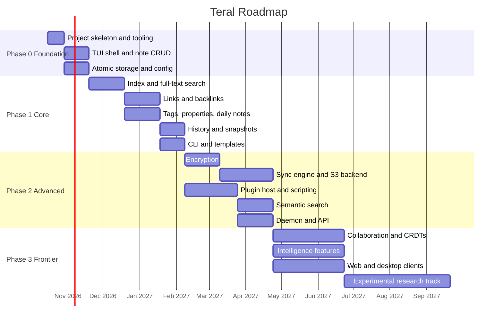

### 10.2 Milestones

| Milestone | Phase | Deliverable                   | Exit criteria                                                       |
| --------- | ----- | ----------------------------- | ------------------------------------------------------------------- |
| M0        | 0     | Usable local note editor      | Create, edit, list, delete notes; atomic writes; unit tests passing |
| M1        | 0     | Stable core library           | UI-independent `core` packages, documented interfaces             |
| M2        | 1     | Searchable linked vault       | FTS, backlinks, tags, properties, 10k-note benchmark met            |
| M3        | 1     | History and CLI               | Snapshots, restore, scriptable CLI, templates                       |
| M4        | 2     | Secure vault                  | End-to-end encryption, reviewed threat model                        |
| M5        | 2     | Multi-device sync             | S3 and Git sync, conflict handling, resumable transfers             |
| M6        | 2     | Extensible platform           | Plugin host, scripting, daemon, public API v1                       |
| M7        | 3     | Intelligent and collaborative | Semantic search, RAG, CRDT co-editing                               |
| M8        | 3     | Multi-frontend                | Web and desktop clients on the shared API                           |

### 10.3 Development Method

Each feature ships incrementally: one focused change at a time, with tests, a short design note explaining the reasoning behind the decision, and a small, reviewable commit.

---

## 11. Technology Stack

| Concern             | Choice                                       | Rationale                                                           |
| ------------------- | -------------------------------------------- | ------------------------------------------------------------------- |
| Language            | Go 1.22+                                     | Static binaries, strong concurrency, fast builds, excellent tooling |
| TUI framework       | Bubble Tea, Bubbles, Lip Gloss               | Elm architecture, composable components, mature ecosystem           |
| Markdown parsing    | goldmark                                     | Extensible, CommonMark compliant, AST access                        |
| Markdown rendering  | glamour or custom renderer                   | Terminal-friendly styled output                                     |
| Index and metadata  | SQLite with FTS5                             | Embedded, fast, reliable, single-file                               |
| SQLite driver       | modernc.org/sqlite                           | Pure Go, no CGO, simple cross-compilation                           |
| Vector search       | sqlite-vec or custom HNSW                    | Local semantic search without external services                     |
| File watching       | fsnotify                                     | Cross-platform change detection                                     |
| Configuration       | TOML via pelletier/go-toml                   | Human-friendly, typed                                               |
| CLI                 | cobra                                        | Subcommands, completions, help generation                           |
| Logging             | log/slog                                     | Standard library structured logging                                 |
| Encryption          | x/crypto: XChaCha20-Poly1305, Argon2id       | Modern, audited primitives                                          |
| Diffing and merging | diff-match-patch, custom three-way merge     | Text and word-level diffs                                           |
| CRDT                | Custom or Yjs-compatible port                | Real-time collaboration                                             |
| Plugins             | hashicorp/go-plugin and WebAssembly (wazero) | Process isolation and sandboxing                                    |
| Scripting           | Lua (gopher-lua) or Starlark                 | Embeddable, sandboxable                                             |
| API                 | net/http, gRPC, Protocol Buffers             | Typed, language-neutral clients                                     |
| Cloud               | AWS SDK for Go v2                            | S3 sync, plus a learning path through AWS services                  |
| Testing             | testing, testify, rapid, go-fuzz             | Unit, property-based, and fuzz tests                                |
| Build and release   | Make, GoReleaser, GitHub Actions             | Reproducible builds and multi-platform packaging                    |

---

## 12. Repository Structure

```text
teral/
├── cmd/
│   ├── teral/                 main binary: TUI and CLI entry
│   └── terald/               background daemon
├── internal/
│   ├── core/
│   │   ├── vault/             vault lifecycle and configuration
│   │   ├── note/              note model, parsing, serialization
│   │   ├── link/              link extraction and resolution
│   │   ├── graph/             graph algorithms and analytics
│   │   ├── search/            query parser, planner, ranking
│   │   ├── task/              task parsing and scheduling
│   │   ├── template/          template engine
│   │   ├── history/           snapshots, deltas, diffs
│   │   └── event/             typed event bus
│   ├── storage/
│   │   ├── fs/                filesystem adapter, atomic writes
│   │   ├── index/             SQLite index and FTS
│   │   ├── vector/            embedding store
│   │   └── crypto/            encryption layer
│   ├── sync/
│   │   ├── engine/            diffing, manifests, conflict resolution
│   │   ├── s3/                object storage backend
│   │   ├── git/               git backend
│   │   └── p2p/               peer-to-peer transport
│   ├── plugin/                host, sandbox, RPC protocol
│   ├── script/                scripting runtime
│   ├── ai/                    embedding and model adapters
│   ├── api/                   HTTP and gRPC servers
│   └── tui/
│       ├── app/               root model, routing
│       ├── components/        editor, list, preview, palette, panels
│       ├── keymap/            key bindings and modes
│       └── theme/             styles and color schemes
├── pkg/                       public, stable packages for plugin authors
├── api/                       protobuf definitions and OpenAPI spec
├── plugins/                   first-party example plugins
├── templates/                 default note templates
├── themes/                    bundled themes
├── docs/
│   ├── architecture/          design documents and decision records
│   ├── file-format.md         formal vault and note specification
│   ├── plugin-api.md
│   └── sync-protocol.md
├── scripts/                   development and release scripts
├── test/                      integration tests and fixtures
├── .github/workflows/         CI pipelines
├── Makefile
├── go.mod
└── README.md
```

---

## 13. Getting Started

### 13.1 Prerequisites

- Go 1.22 or newer
- Make (on Windows: `choco install make`)
- A terminal with 256-color support. True color and a graphics protocol are recommended.

### 13.2 Build and Run

```bash
git clone https://github.com/sahilmadaan048/teral.git
cd teral

# install dependencies
go mod tidy

# build the binary
make build

# build and run
make run
```

### 13.3 Makefile Targets (planned)

| Target             | Purpose                                  |
| ------------------ | ---------------------------------------- |
| `make build`     | Compile the binary                       |
| `make run`       | Build and launch the TUI                 |
| `make test`      | Run unit tests                           |
| `make test-race` | Run tests with the race detector         |
| `make bench`     | Run benchmarks                           |
| `make lint`      | Run static analysis                      |
| `make fmt`       | Format the source tree                   |
| `make cover`     | Generate a coverage report               |
| `make release`   | Produce multi-platform release artifacts |
| `make clean`     | Remove build outputs                     |

### 13.4 First Run

On first launch Teral creates a default vault, writes a starter configuration, and opens a welcome note describing the interface. Point it at an existing folder of Markdown files with:

```bash
teral --vault /path/to/notes
```

---

## 14. Configuration

Configuration is layered: built-in defaults, then the user file, then the vault file, then environment variables, then command line flags.

```toml
# ~/.config/teral/config.toml

[vault]
path = "~/teral"
default_folder = "inbox"
autosave_interval = "2s"

[editor]
keymap = "default"          # default | vim | emacs
wrap = true
line_numbers = false
tab_width = 4

[ui]
theme = "teral-dark"
show_help_bar = true
preview = "side"            # off | side | below

[index]
watch = true
embeddings = false
fts_tokenizer = "porter unicode61"

[history]
snapshots = true
retention_days = 90

[encryption]
enabled = false
kdf = "argon2id"

[sync]
backend = "none"            # none | git | s3 | p2p
interval = "5m"

[sync.s3]
bucket = ""
region = ""
prefix = "teral/"

[ai]
provider = "none"           # none | local | remote
model = ""

[logging]
level = "info"
file = "~/.local/state/teral/teral.log"
```

---

## 15. Keybindings

Default bindings for the first release. All bindings are remappable.

| Key                          | Action                                   |
| ---------------------------- | ---------------------------------------- |
| `Ctrl+N`                   | Create a new note                        |
| `Ctrl+L`                   | List and filter notes                    |
| `Ctrl+S`                   | Save current note                        |
| `Ctrl+D`                   | Delete current note (with confirmation)  |
| `Ctrl+P`                   | Open command palette                     |
| `Ctrl+F`                   | Search in note                           |
| `Ctrl+Shift+F`             | Search across vault                      |
| `Ctrl+K`                   | Insert or follow link                    |
| `Ctrl+B`                   | Toggle backlinks panel                   |
| `Ctrl+G`                   | Toggle graph view                        |
| `Ctrl+E`                   | Toggle preview                           |
| `Ctrl+T`                   | New tab                                  |
| `Ctrl+W`                   | Close tab                                |
| `Alt+Left` / `Alt+Right` | Navigate back and forward                |
| `Esc`                      | Close overlay or return to previous view |
| `Ctrl+Q`                   | Quit                                     |

---

## 16. Command Line Interface

The CLI is designed for scripting and Unix pipelines. Every command supports `--json`.

```bash
# capture
teral new "Meeting notes" --tag work --template meeting
echo "Buy milk" | teral capture --to inbox

# navigate
teral open "Write-Ahead Log"
teral list --tag systems --sort modified
teral daily                       # open or create today's note

# search
teral search "crash recovery" --limit 10
teral search --semantic "how do databases survive power loss"
teral query 'tag:systems AND updated:>2026-09-01'

# graph
teral backlinks "Write-Ahead Log"
teral graph --depth 2 --format dot > graph.dot
teral orphans

# maintenance
teral doctor
teral reindex --full
teral stats

# history
teral history "Write-Ahead Log"
teral restore "Write-Ahead Log" --at 2026-10-01

# sync and backup
teral sync
teral backup --to s3://my-bucket/teral

# import and export
teral import obsidian ~/ObsidianVault
teral export --format html --out ./site

# server
teral serve --addr 127.0.0.1:7878
```

---

## 17. Performance Targets

Targets are measured on a mid-range laptop with an SSD and a vault of 10,000 notes.

| Metric                          | Target              |
| ------------------------------- | ------------------- |
| Cold start to interactive UI    | under 100 ms        |
| Open a note                     | under 10 ms         |
| Save a note                     | under 20 ms, atomic |
| Incremental reindex of one note | under 30 ms         |
| Full reindex of 10,000 notes    | under 20 s          |
| Full-text search                | under 50 ms         |
| Semantic search                 | under 150 ms        |
| Backlink lookup                 | under 10 ms         |
| Memory footprint, idle          | under 80 MB         |
| Binary size                     | under 40 MB         |

Performance strategy:

- Incremental indexing keyed by modification time and content hash
- Debounced file watching and batched index transactions
- Lazy loading and virtualized rendering for long lists and large notes
- Worker pools with bounded concurrency and backpressure
- Prepared statements, WAL mode, and carefully designed indexes in SQLite
- Zero-copy parsing where possible and pooled buffers for hot paths
- Continuous benchmarking in CI with regression alerts

---

## 18. Security Model

### 18.1 Threat Model Summary

| Threat                          | Mitigation                                                        |
| ------------------------------- | ----------------------------------------------------------------- |
| Lost or stolen device           | Vault encryption at rest, auto-lock, key zeroization              |
| Compromised sync server         | Client-side encryption, server sees only ciphertext and sizes     |
| Malicious plugin                | Permission manifest, process or WASM sandbox, capability checks   |
| Data corruption or crash        | Atomic writes, checksums, snapshots, recovery tooling             |
| Accidental deletion             | Trash, history, point-in-time restore                             |
| Supply chain attack             | Pinned dependencies, checksum verification, signed releases, SBOM |
| Local malware reading the index | Encrypted index option, restrictive file permissions              |

### 18.2 Encryption Design

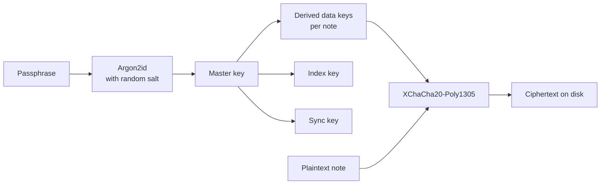

### 18.3 Security Practices

- Dependencies pinned and audited; vulnerability scanning in CI
- Fuzz testing on all parsers and deserializers
- Plugin permissions are explicit, minimal, and reviewable
- Responsible disclosure policy documented in `SECURITY.md`

---

## 19. Testing and Quality Strategy

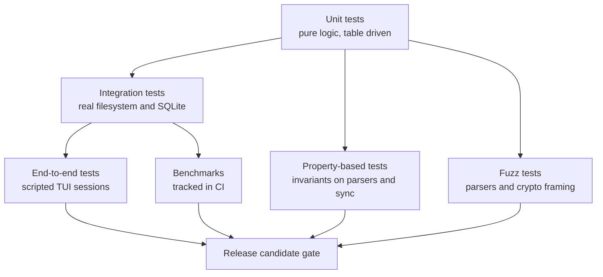

- **Unit tests** cover note parsing, link resolution, query planning, and every `Update` function in the TUI, which is deterministic by design.
- **Integration tests** run against temporary vaults generated from fixtures.
- **Property-based tests** assert invariants such as "parse then serialize is lossless" and "sync converges regardless of operation order".
- **Fuzzing** protects every parser exposed to untrusted input.
- **Golden tests** lock rendering output for themes and Markdown elements.
- **Benchmarks** guard the performance targets above.
- **Coverage and static analysis** are enforced in CI: `go vet`, `staticcheck`, `golangci-lint`, and the race detector.

Continuous integration runs on Linux, macOS, and Windows for every pull request.

---

## 20. Contributing

Contributions of every kind are welcome once the foundation stabilizes.

1. Open an issue describing the problem or proposal.
2. For larger changes, add a short design note under `docs/architecture/`.
3. Keep changes small and focused, with tests.
4. Follow the project style: `gofmt`, documented exported symbols, meaningful error wrapping.
5. Use conventional commit messages, for example `feat(search): add fuzzy title matching`.

Detailed guidelines will live in `CONTRIBUTING.md`.

---

## 21. Acknowledgements

Teral began as an exploration based on a tutorial TUI notes application (Totion) built with Bubble Tea, which served as the reference for the Elm architecture and terminal UI patterns. It is being rebuilt from the ground up with a different scope: a layered, testable, extensible knowledge platform.

Inspiration and prior art: Obsidian, Logseq, Org-mode, Zettelkasten practice, Notational Velocity, Joplin, and the Charm ecosystem for terminal software.

---

## 22. License

Released under the MIT License. See `LICENSE` for details.
